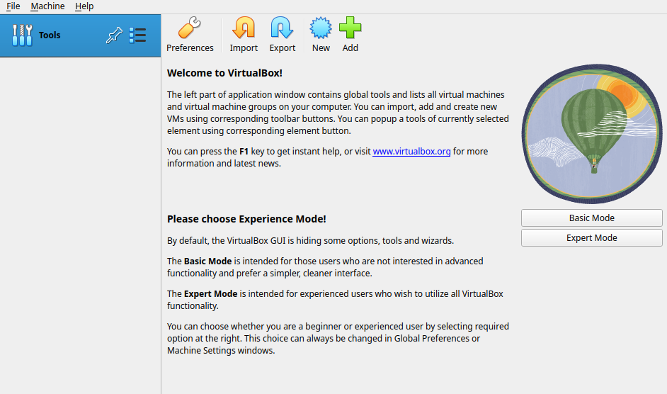
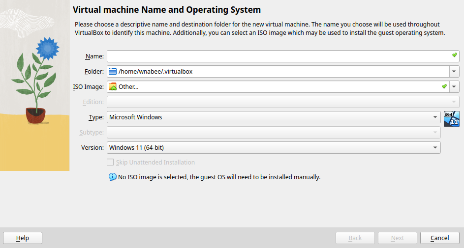
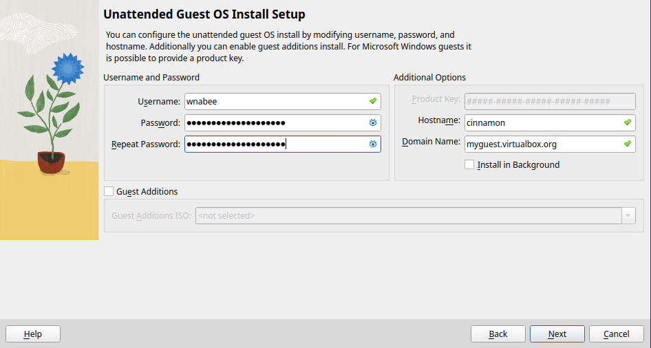
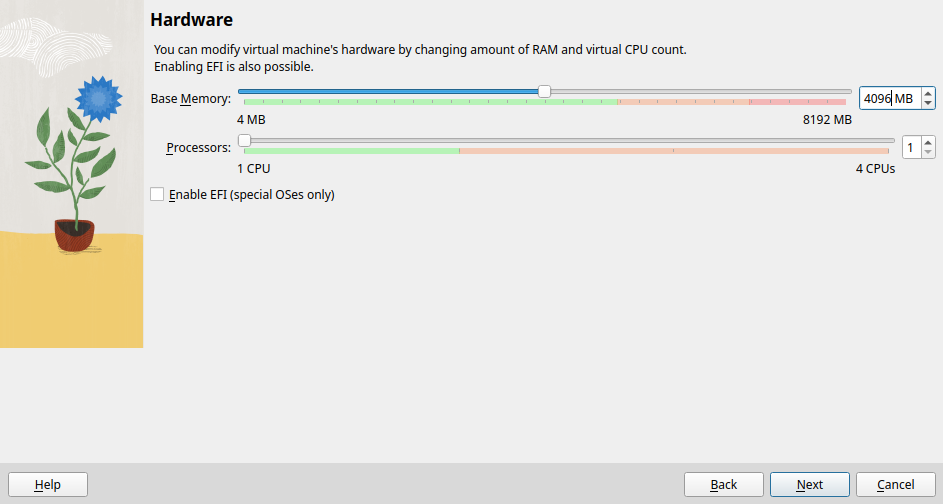
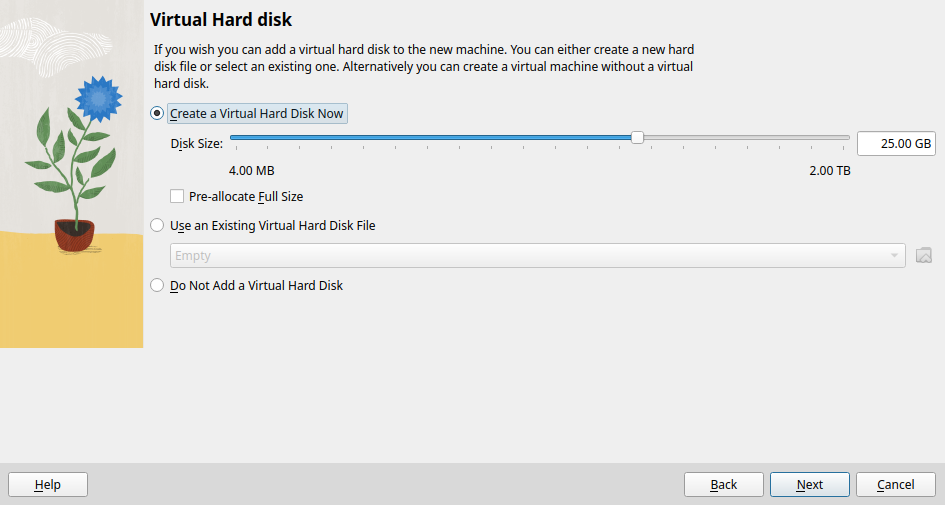

# Kom igång med Linux

Att installera linux för första gången kan tros vara krångligt och svårt. 
Sånt är inte fallet. Det finns många sätt att doppa tårna i Linuxvärlden
för att se om det är ett operativsystem som passar dig, här går vi igenom dem.

I denna artikel antas det att du i dagsläget använder windows.

## ISO-fil

En ISO-fil är (för våra syften) en fil som innehåller ditt operativsystems
installationsmedium. Olika operativsystem tillhandahåller länkar för att ladda
ner deras ISO-filer på sina hemsidor. I denna guide kommer vi att installera
[linux mint](https://linuxmint.com/), en nybörjarvänlig linuxdistribution som
`helt enkelt funkar`™. Deras ISO-fil finns tillgänglig för nedladdning
[här](https://linuxmint.com/download.php). ISO-filen hämtas mest lämpligen som
en torrent, men då torrentprotokollet blivit smutskastat bland
internetleverantörer på grund av piratkopiering finns även
nedladdningsalternativ via https tillgängliga på sidan.

## Live-sticka

Ett sätt att testa linux är med hjälp av en så kallad live-sticka, en usb-sticka
som har ett helt linuxoperativsystem på sig. Live-stickan ger dig ett smakprov
av hur det är att använda linux utan att ändra något på din vanliga dator.
För att återgå till ditt vanliga operativsystem räcker det att koppla ur
live-stickan och starta om maskinen.

Ett vanligt sätt att skapa live-stickor på windows är med hjälp av
[Etcher](https://etcher.balena.io/). [Etcher](https://etcher.balena.io/) tar en
ISO-fil som indata och skriver till en USB-sticka inkopplad i din dator. När 
[Etcher](https://etcher.balena.io/) kört klart har du en live-sticka.
För att komma in i live-stickans miljö:

* Starta om datorn.
* Öppna ditt BIOS.
* Navigera till Bootmenyn i BIOS.
* Välj din USB-sticka som förstahandsval vid uppstart.
* Spara och lämna BIOS.

När datorn nu startar upp kommer du komma till en tillfällig Linuxmiljö. Här
kan du prova på att använda Linux mint, och om det känns bra kan du även
INstallera operativsystemet permanent härifrån genom att följa deras
[guide](https://linuxmint-installation-guide.readthedocs.io/en/latest/install.html).

## Virtuell maskin

Ett annat mer komplicerat sätt att leka med linuxdistrubutioner är att sätta
upp en virtuell maskin. Virtuella maskiner är isolerade datorer i din dator som
beter sig som hela operativsystem. Ett vanligt virtualiseringsprogram som ofta
används på windows är [Virtualbox](https://www.virtualbox.org/wiki/Downloads).
På Windows vill du som användare ladda hem `Virtualbox platform package for
windows hosts`. När du startar programmet kommer du bemötas av följande grafiska 
gränssnitt.

I detta gränsnitt väljer du sedan "New" för att öppna en dialog:

Här namnger du din virtuella maskin och väljer sedan din ISO-fil genom att trycka
på ISO-image-fältet följt av "Other" innan du trycker "Next".

På dialogen i ovanstående bild väljer du ett användarnamn och [lämpligt lösenord](../../annat/lösenord.md) 
för att logga in på din dator innan du trycker "Next".

I ovanstående dialog väljer du RAM minne och CPU-kraft. 4096 MB RAM och 1 CPU
kärna ska räcka ganska långt, men om du har datorkraft så det räcker och blir över är det
inte fel att göra VM:en kraftfullare. När du valt hur mycket kräm VM:en ska få så kan
du trycka "Next"

Därefter väljer du lagringsutrymmet på din VM, för din första VM kommer 25 GB
att räcka. 

Om du får slut på plats kan du enkelt följa denna guide igen för att
skapa en ny VM med mer lagringsutrymme, eller överväga att installera Linux
direkt på din hårdvara. Linux kan nämligen också virtualisera och är ofta mer
lämpligt att använda som basoperativsystem då det i regel är mindre
prestandakrävande än Windows. Det går såklart att virtualisera Windows om man
nu vill göra det. När du valt ditt lagringsutrymme kan du trycka "Next", se över
dina specifikationer och sedan trycka "Finish". Därefter kan du starta VM:en
och följa Linux mints
[installationsguide](https://linuxmint-installation-guide.readthedocs.io/en/latest/install.html).

Om allt gått som det ska har du nu en fullt installerad linux mint VM. Här kan
du leka runt, ta sönder saker och experimentera. om något går fel är det enkelt
att skapa en ny VM för att ersätta den gamla. Söktermer som kan vara värda att
slå upp i valfri sökmotor är "virtualbox guest tools" och "virtualbox snapshots".

Lycka till!
