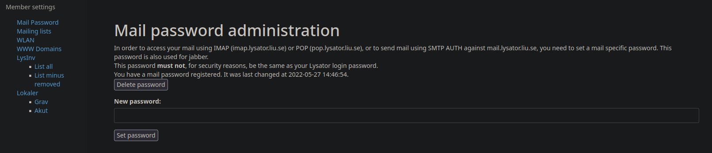

# Kom igång med epost

Lysator driver en egen epostserver.</br>
Genom den får du en epostaddress på `[användarnamn]@lysator.liu.se`.

## Sätt lösenord

För att nå din epostinkorg måste du först sätta ett dedikerat epostlösenord.
Navigera till [administrationsgränssnittet](https://admin.lysator.liu.se/mail)
på 
```
https://admin.lysator.liu.se/mail
```
och logga in med ditt lysatorkonto.
Där kommer du att bemötas av ett inmatningsfält betecknat "New password".
Skriv in ditt önskade lösenord, som bör vara annorlunda än ditt ordinarie
Lysatorlösenord och tryck "Set password".



## Webbmail

När ditt lösenord är satt kan du nu navigera till
```
webmail.lysator.liu.se
```
och logga in med ditt nysatta lösenord samt lysatoranvändarnamn.
Du har nu en minimal konfiguration för att använda lysators epost.

## Vidare läsning

Om du inte är belåten med att vara inlåst i en webbläsare för att komma åt din
epost, vill få din epost vidarebefodrad till en annan address eller vill sätta
upp epostmappsregler samt filtrering så kan du läsa mer om hur en Lysit
förvaltar sin epost i artikeln [Elektronisk post på Lysatorvis](../../tjänster/kommunikation/elektronisk-post-på-lysatorvis/index.md).
