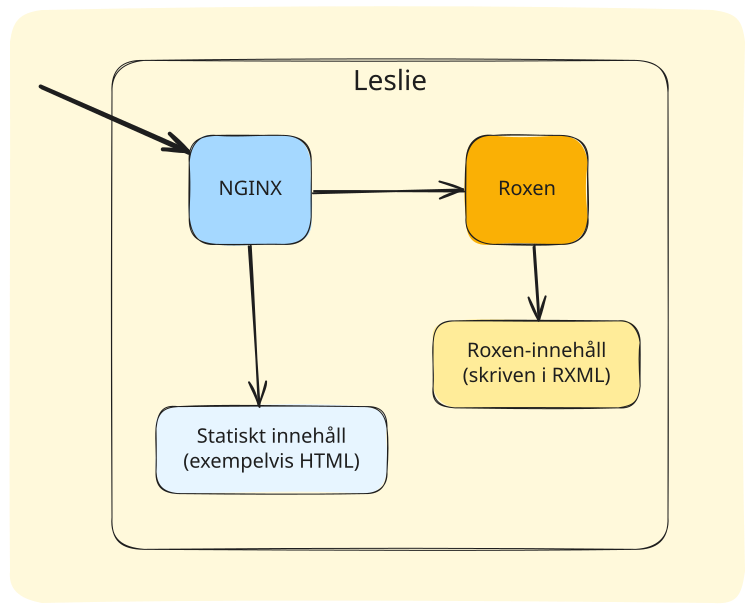

Den nya webbservermaskinen som ersätter [Knuth](https://datorhandbok.lysator.liu.se/index.php/Knuth).

## Översikt

Leslie gör tre jobb:

1. Servera statiska sidor, genom nginx.
2. Servera användarsidor, genom Roxen.
2. Servera "legacy"-sidor, genom Roxen.

nginx är installerad på systemet, medan Roxen körs i en Docker-container.

## Blockdiagram
Flödet av pilar visar hur en förfrågan kan bli löst.
<!-- https://excalidraw.com/#json=FgUCST401wW4875E3ga85,oezOFI25OVms1kep5g9I1w -->

## nginx

...
