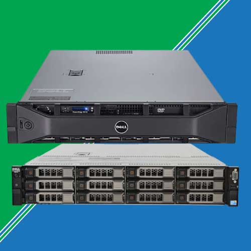

# Dell R510

Dell R510 är en mindre disklåda med plats för 12st 3.5'' SAS-diskar framtill
samt 2st 2.5'' SAS-diskar inuti.

!!! warning "Arkitektur"
    Modellen har en processor med x86_64-v2, vilket gör det omöjligt att boota
    exempelvis RHEL10 på den. Alma Linux har dock en port tillgänglig med stöd
    för arkitekturen.

## BIOS
För att komma åt BIOS, tryck på F2 under maskinens start. Rekommenderat är att
sätta boot-typ till UEFI och ställa in ströminställningen att starta maskinen
efter elavbrott. **Sätt inte strömmen till _on_, utan _previous_.** Detta
hindrar maskinen från att starta i onödan om den sätts ur drift. Sätt på samma
sätt gärna även fördröjningen så att den väntar en slumpmässig mängd tid innan
den startar. Detta sparar på strömförsörjningen i BAR.

## Management (iDRAC)
För att använda management-gui på R510, använd först `ipmitool` på systemet för
att ansluta till [management-nätet](../nätverk/management-nätet.md). Sätt också
användare och lösenord.

Därefter anslut via [proxy](../../annat/proxy-via-lysator.md) till orwell och gå
in med en webbläsare på enhetens management-ip. Använd användaren och lösenordet
som sattes med `ipmitool`.

!!! note "SSL"
    Dells iDRAC är så gammal på enheterna att den kör SSL. För att en
    modern webbläsare ska kunna ansluta till den måste man acceptera sårbara
    TLS-versioner. I Firefox kan detta göras genom att gå in i about:config och
    sätta `security.tls.version.enable-deprecated` till `true`.

## RAID-kontroller
Under start kan man nå RAID-kontrollern genom att klicka på CTRL-R. För att
skapa en fräsch konfiguration, sätt indikatorn över RAID-kontrollern på toppnivå
och tryck F2. Detta kommer visa en meny med flera möjliga åtgärder. Börja
med att trycka på _Clear Config_, vilket kommer städa undan alla existerande
inställningar.

Därefter kommer alla diskar vara obumndna, så konfigurera dem genom att återigen
trycka på F2 över kontrollern och denna gång välja _Create New VD_. Detta skapar
en virtuell disk. Om du vill köra ZFS kan du helt enkelt skapa _x_ stycken RAID0
VD:ar, där x är mängden disk du har. Dessa kommer vidarebefordras till linux.

När du är klar, gå ut via ESC.

!!! warning "Byte av disk."
    RAID-kontrollern blir väldigt arg om en disk dör, så pass arg att den vägrar
    starta datorn så länge man inte åtgärdar felet. Närvara därför fysiskt om du
    startar om en R510 efter ett diskbyte. Utbytt disk måste läggas till som en
    VD enligt ovanstående för att fungera.

## UEFI Boot Manager
Man kommer åt _UEFI Boot Managern_ genom att trycka på F11 under systemets
start. Där kan man bland annat välja vilken USB man ska starta från, men även
flera andra användbara saker.

- Under _UEFI Boot Settings_ kan man hantera vilka enheter ska visas i
  startmenyn, men också starta från en specifik fil.
- Under _System Utilities_ kan man gå in i BIOS, gå in i _Lifecycle Managern_,
  eller starta från en BIOS-källa och starta _Serverkonfiguratorn_.

## Uppdatering av BIOS, Firmware, och iDRAC
Ge upp allt hopp, du som härigenom passerar. Att uppdatera en Dell R510 är en
_horribel_ upplevelse.

Vårt mål är att uppdatera till _relativt_ ny firmware och nyaste BIOS. Tyvärr
kan vi inte bara dra ner nyaste firmware, sätta det på en USB-sticka, och be
servern uppdatera sig från det. Servern verifierar nämligen signaturer så att
alla uppdateringar är "auktoriserade" av Dell. Vi börjar därför med att uppdatera
iDRAC.

Ladda ner nyaste iDRAC från Dells hemsida. Detta är vid skrivtid
[version 2.92](https://www.dell.com/support/home/en-us/drivers/driversdetails?driverid=kpccc&oscode=ws8r2&productcode=poweredge-r510).
Nyare versioner kan dock finnas
[här](https://www.dell.com/support/product-details/en-us/product/poweredge-r510/drivers).
Välj versionen för Windows 32-bit och extrahera EXE-filen som ett zip-arkiv.
Däri hittas mappen `payload` som innehåller den nya iDRAC-versionen.

!!! warning "Win32"
    Win64-binärer får uppdateringen att krascha.

Gå in i webb-gui:t och starta uppdateringsverktyget. Ladda upp filen i `payload`
och bekräfta systemet ska uppdateras. Detta kommer ta en stund, och iDRAC:en
kommer starta om. Det tar ett flertal minuter innan den kommer igång igen, så
var inte orolig för att något har gått sönder.

Gå återigen in i iDRAC:en och navigera till uppdateringsvyn. Denna gång ska vi
uppdatera _Dell Lifecycle Manager_ till nyaste versionen. Vid skrivtid är den
[1.7.5](https://www.dell.com/support/home/en-us/drivers/driversdetails?driverid=80xj1&oscode=ws8r2&productcode=poweredge-r510)
Hemsidan kallar filen en "Repair Package", men den kan bara laddas upp i
uppdateringsvyn. (Ingen unzip krävs.) Bekräfta igen att kontrollern ska
uppdateras, och vänta tills det blir klart.

Nu har vi kommit till en punkt där vi kan uppdatera systemet via FTP.
Lifecycle-kontrollern är tillräckligt ny för att verifiera och installera
rimligt ny firmware.

Starta om datorn och tryck på F10 för att gå in i _Dell Lifecycle
Controller_Starta om datorn och tryck på F10 för att gå in
i _Dell Lifecycle Controller_. Sätt upp nätverk (helst via
[skuldafn-nätet](../nätverk/skuldafn.md)), och gå in i DLC:ns uppdateringsvy.

Dell har sedan länge stängt ner sin FTP-server, så vi
tvingas använda en inofficiell spegel. Vid skrivtid finns
[ftp.updateyodell.net](ftp://ftp.updateyodell.net). De har en hemsida vid
[updateyodell.net](https://updateyodell.net). Följ instruktionerna där. Vid
skrivtid är dessa:

| Fält         | Värde                  |
|--------------|------------------------|
| Adress       | `ftp.updateyodell.net` |
| Användarnamn | `dell`                 |
| Lösenord     | `calvin`               |
| Path         | `g11`                  |

Alla tillgängliga uppdateringar kommer presenteras i en tabell. Välj alla som
kan appliceras och gå vidare. Denna uppdatering kan ta _mycket_ tid.

När allt är klart ska vi ha relativt ny firmware och BIOS på allt. Det enda som
är kvar är att uppdatera till nyaste BIOS. Nyaste versionen är vid skrivtid
[1.14.0](https://www.dell.com/support/home/en-us/drivers/driversdetails?driverid=pycxx&oscode=ws8r2&productcode=poweredge-r510).
Se till att ladda ner versionen som kallas **Flash BIOS Executable** För att
installera denna, gå först till [freedos.org](https://freedos.org/download/),
ladda ner en ISO-fil, bränn den till ett USB, montera USB:t på din dator, och
kopiera BIOS-filen till dess root. Starta slutligen upp R510:an från USB:t och
kör BIOS-filen med `.\BIOS.EXE`. Detta bör uppdatera servern till nyaste BIOS.
