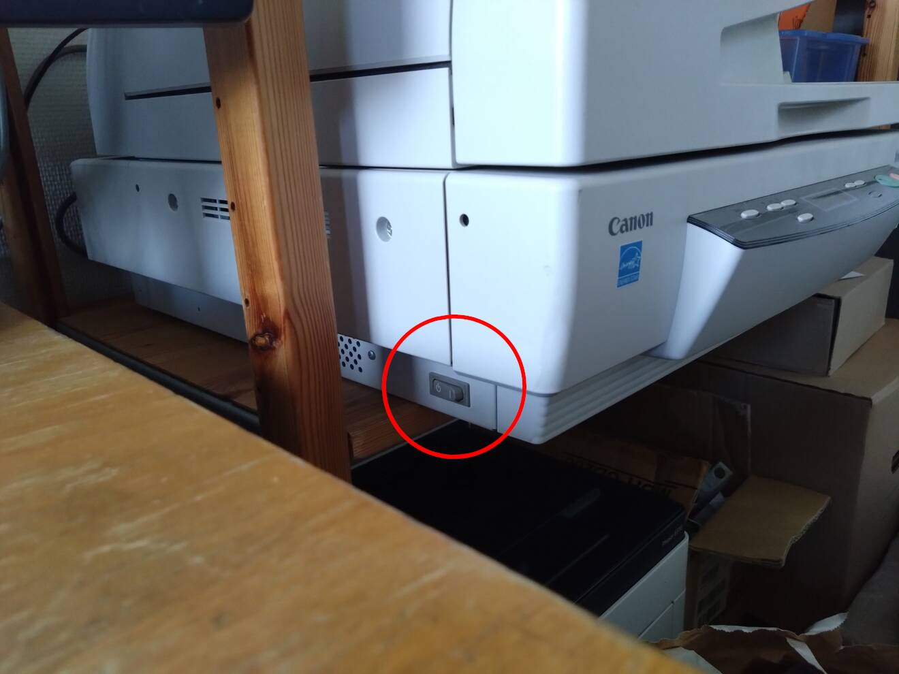

# skrivare och scanner

## Skriva ut
I Lysators lokaler finns skrivare och scanner som kan användas av medlemmar utan extra kostnad.

Skrivaren är nätansluten och går att komma åt via någon av arbetsstationerna. För att använda skrivaren välj "urd" som enhet och välj därefter de inställningar som behövs för din utskrift.

Ibland kommer utskrifen inte igång av sig själv då skrivaren är satt i strömsparläge. För att få igång skrivaren igen gör manj ett kort tryck på "power" knappen till vänster på skrivarens ovansida.

### Grafiska gränssnitt
Skrivaren kommer automatiskt att synas i listan över tillgängliga skrivare i din skrivbordsmiljö. I exempelvis Gnome, KDE och Cinnamon är detta testat och fungerar (i skrivande stund). De flesta program som exempelvis firefox, eller någon av alla installerade PDF-läsare borde också kunna hitta anslutna skrivare.

### Utskrift via kommandoraden

För utskrift via kommandoraden används lämpligen kommandot `lp` med familj..

Snabbhjälp för kommandot hittar du via: `lp --help`

För att lista tillgängliga skrivare kan du använda: `lpstat -v` <br> (I 9/10 fall kommer du nog att använda "urd")

För att skriva ut en PDF med standardinställnignar: `lp -d urd <namn på dokument>.pdf`

### Ful nätverksutskrift

För att snabbt och smidigt skriva ut en lokal fil, pipe:a innehållet av filen till `ssh borsalino -- lp -`.
```
cat file.pdf | ssh borsalino -- lp -
```

Utanför lysators nät måste du tillägga `.lysator.liu.se` efter `borsalino`.


## Scanna In

En scanner finns ansluten via USB till arbetsstationen Borsalino. Scannern är kabapel till att scanna in dokument i A3 storlek och mindre. Det finns även en autoscanningsfunktion likt Universitetets Xerox maskiner, men vi har ännu inte lurat ut hur man använder den. Lyckas du med det, skriv här! :D

!!! warning "Sätt på strömmen!"
    För att använda scannern, se till att den är påslagen via huvudströmbrytaren (sitter på scannerns vänsta kortsida), och att den är ordentligt ansluten via USB.
    

### Grafiska gränssnit
För Gnome, KDE och Cinnamon finns applikationen "Document Scanner". Den är hyfsat intuitiv att använda och har gott om inställningar att pilla med.

### Inscanning via kommandoraden
För inscanning via kommandoraden finns verktyget `scanimage`. Det är ett kraftfullt verktyg som kan användas för att bygga skrift och att komma åt alla möjliga inställningar på scannern. Det är dock inte särsklit användarvänligt.

`scanimage -L` listar upptäckta scanners.

Exempel på ett kommando för att scanna in en sida med scanimage är <br> `scanimage --batch --batch-prompt --mode Color --format pdf -d '<namn_på_scanner>' --resolution 300`

```
scanimage --resolution 300 --format=jpeg --source="ADF Front" > x.jpeg
```

```
 scanimage \
  --resolution 300 \
  --format=jpeg \
  --source="ADF Front" \
  --batch-count=2 \
  --batch="page%03d.jpeg"
```
