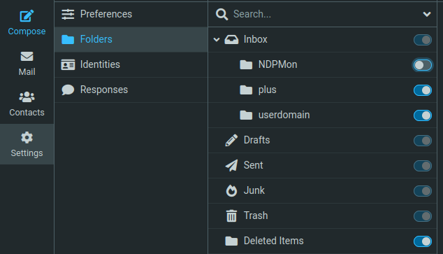

Detta är en hyfsat detaljerad guide över olika sätt att använda Lysators e-post server.

## E-post konto
För att komma åt mail via [webmail](https://webmail.lysator.liu.se) eller extern e-post klient måste du sätta ett e-post lösenord på [admin/mail](https://admin.lysator.liu.se/mail). 

## Läsa e-post
Alla de olika sätt som du kan komma åt din e-post på!

### Webmail
[webmail.lysator.liu.se](https://webmail.lysator.liu.se) låter dig läsa skriva och organisera din e-post i webbläsaren. Vi kör för tillfället [roundcube](https://roundcube.net/) som webmail-klient.

För att logga in använder du det lösenord du satt i [admin](https://admin.lysator.liu.se/mail). 

### IMAP, POP och SMTP
Med dessa kan du ansluta exempelvis [thunderbird](https://www.thunderbird.net) eller andra mailklienter. Det rekommenderas att använda TLS kryptering om du ska ansluta till dessa. Om du väljer en "okrypterad" anslutningstyp måste du använda STARTTLS för att kunna logga in.

Som användarnamn används ditt vanliga användarnamn.
Som lösenord ska du använda det lösenord du satt för mail i [admin](https://admin.lysator.liu.se/mail).

Portar för att ansluta klienten:

*Inkommande server:*
```
	MAP 	    imap.lysator.liu.se 	port 143
	IMAP/TLS 	imap.lysator.liu.se 	port 993
   	POP3 	    pop.lysator.liu.se 	    port 110
	POP3/TLS 	pop.lysator.liu.se 	    port 995
```

*Utgående server:*
```
    SMTP        mail.lysator.liu.se     port 26
```

### Läsa mail lokalt

#### Mutt

## Mail-mappen

Alla lysators system monterar användarens mail-mapp på `/var/mail/<användarnamn>`. Det finns många gömda filer (dot-files) som kan vara viktiga. Kör `ls -a`.

Följande avsnitt beskriver vad de flesta av dessa filer är och hur de används.

### Vidarebefordring
Om du vill att din e-post ska vidarebefordras till någon annan brevlåda (exempelvis din studentmail eller annat) så måste du redigera din `.forward` i din mail-mapp.

För att vidarebefordra mail skriver du enkelt in adressen till den brevlåda du vill ha e-posten levererad till och sparar filen. **E-post kommer inte att sparas på lysators mailserver om detta görs! E-posten blir endast vidarebefordrad.**

`.forward` kan även skicka vidare e-post till andra ställen också, exempelvis mailsorteringsprogrammet procmail som bland annat kan användas för att filtrera bort spam-mail. Exempel på hur du använder procmail finner du i nästa avsnitt.

### Spamhantering och andra automatiska regler

> Denna guide är tolkad från <https://datorhandbok.lysator.liu.se/index.php/Procmail>

Är detta din inkorg?

- "Quick solution for your auto part needs"

- "Kan jag vara din älskarinna"

- "SISTA VARNING: alla dina foton, mappar och filer kommer att raderas."

Då kanske du är intresserad av att sätta upp regler som automatiskt filtrerar din inkommande mail! Det kan du göra med **procmail**.

#### Att sätta upp procmail på sitt konto

För att konfigurera procmail, behövs en inställningsfil `.procmailrc`. Det är också lämpligt att ha en katalog `.procmail` innehållande filter, och loggar som procmail skapar.

För att överhuvudtaget köra procmail för inkommande post måste man ändra sin `.forward`.

#### Skapa en `.procmailrc`
Det första steget är att skapa inställningsfilen `.procmailrc` i roten på din mailspool `/var/mail/$USER`. Följande exempel kan med fördel användas:

```
# Set on when debugging
VERBOSE=off

# TRAILING SLASH IMPORTANT
MAILDIR=$HOME/Maildir/

# Default location for mails that do not match any procmail rules.
DEFAULT=$MAILDIR

# Directory for storing procmail log and rc files
PMDIR=$HOME/.procmail

LOGFILE=$PMDIR/log
```

!!! warning "`.procmailrc` måste ha rätt rättigheter!"
    För att procmail skall våga använda filen får den inte vara skrivbar för någon annan än dig själv, exempelvis 644.

#### Skapa filter
För att definera hur procmail ska hantera inkommande mail (inklusive att filtrera bort spam), behövs filter skapas.

Du kan skriva filter direkt i `.procmailrc`, men lite snyggare är att skriva filter i externa filer och sen inkludera dem.

1. Skapa katalogen `.procmail` om den inte finns.
2. Skapa filen `rc.testing` med följande innehåll:
    ```
    :0:
    * ^Subject:.*test
    .INBOX.test/
    ```
3. Inkludera `rc.testing` i grundkonfigurationen (`.procmailrc`) genom att lägga till följande rad:
    ```
    INCLUDERC=$PMDIR/rc.testing
    ```

#### Skapa `.forward`

Nu är vi nästan redo att testa vår filter! Det som saknas är att faktiskt slussa inkommande mail genom procmail. Det gör du genom att skapa/redigera filen `.forward` som också ligger i roten på din mailspool. Filen ska ha följande innehåll, inklusive citationstecken.
```
"|exec /usr/bin/procmail"
```

!!! warning "`.forward` måste ha rätt rättigheter!"
    För att `.forward` ska fungera får den inte vara skrivbar för någon annan än dig själv, exempelvis 644.

!!! note "Använder du redan `.forward` för vidarebefordring?"
    Om du redan använder din `.forward` för att vidarebefodra post och vill fortsätta med detta ser du till att din forward-instruktion ligger på en egen rad i filen. 

#### En första test av procmail
Nu kan du äntligen testa filtret! Skicka därför ett brev till dig själv där subject-raden innehåller ordet "test". Om procmail fungerar ska detta brev hamna i mailkatalogen `INBOX` > `test`, alltså en katalog under inkorgen. Detta borde även reflekteras i [webmail](#webmail).

När du med ovanstående test klargjort att procmail fungerar kan du kommentera bort den rad i din '.procmailrc' som inkluderar test-filtret. Kommentering sker genom att placera tecknet "#" i början av raden. 

#### Spamfilter
Här är en regel som filtrerar bort väldigt mycket spam som annars släpps igenom på Lysators servrar. Läs detaljerna under koden för att lära dig om varför det fungerar.

Du kan ändra målkatalogen till `/dev/null` för att ta bort spammarkerade mail automatiskt, men smidigast är att matcha katalogen med din e-postklients "skräpkorg". För Roundcube är det `.Junk/`.

!!! note "Se nya kataloger i Roundcube!"
    Om du skapar nya kataloger i din mailspool så måste du aktivera dem i Roundcube. Det görs genom att gå till "Settings" > "Folders" och aktiverar de katalogerna som annars är avaktiverade.
    

```
# SCL, Spam Confidence Level: number between -1 and 9.  5 and  above
# are spam.  -1 means white-listed.
:0 :
* ^X-Forefront-Antispam-Report:.*[ ;,]SCL: *([5-9]|[1-9][0-9])
.Junk/       

# SFV values:
#  - "NSPM":  Non-spam
#  - "SPM":   Spam
#  - "SKB":   A central rule blocking e.g. sender or domain
:0 :
* ^X-Forefront-Antispam-Report:.*[ ;,]SFV: *(SPM|SKB)($|[^A-Za-z0-9_---])
.Junk/
```
Varför funkar regeln ovan?

Lysators e-post ligger bakom LiU, som tillhandahåller ett spamfilter. När mail passerar LiU, läggs en rapport till i headern `X-Forefront-Antispam-Report`. Headern är strukturerad som semikolonseparerade värden.
Exakt vad dessa värden betyder går att läsa [här](https://learn.microsoft.com/en-us/defender-office-365/message-headers-eop-mdo), men troligtvis är det "SFV:SPM" du vill använda.

#### Filter för engångsaddresser
Man kan sätta upp regel för att automatiskt skapa kataloger beroende på vilken [user-domän](#user-doman) mailet skickades till. Så här kan det se ut:

```
# User-domän
:0
* ^TO_\/[a-zA-Z0-9]+@<användare>.user.lysator.liu.se
{
    # Trim domain part from captured MATCH
    :0
    * MATCH ?? ^\/[^@]+
    .INBOX."$MATCH"/
}
```


## Extra adresser

Skulle du behöva extra adresser eller adresser som du kan använda en gång och sen glömma bort för all framtid? Då finns det två smidiga sätt att utöka din ordinarie mailadress. Dessa kan även vara hjälpsamma vid filtrering!

Vilken du väljer att använda beror mest på tycke och smak. I bägge fallen så kommer e-post att levereras till din ordinarie Lysator brevlåda varefter de regler som du satt upp för mailhantering styr vad som händer med e-posten.

### Plus syntax
`användarnamn+prylemoj@lysator.liu.se`
(prylemoj är endast ett exempel, det kan stå vad du vill)

### User-domän
`prylemoj@<användarnamn>.user.lysator.liu.se`
(prylemoj är endast ett exempel, det kan stå vad du vill)

