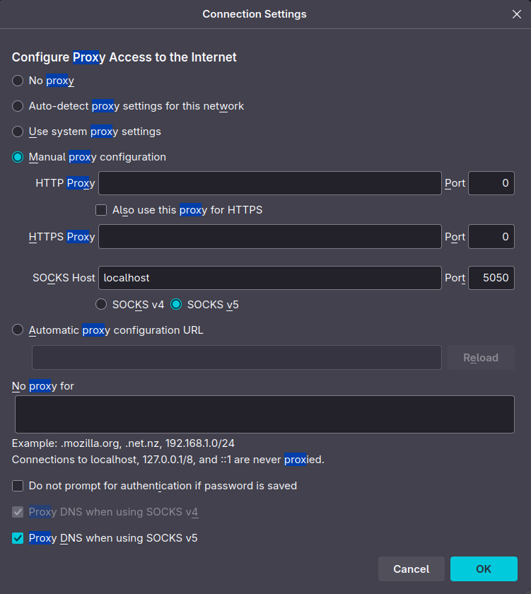

Detta kan göras på flera sett. En metod är att använda `ssh`.

## Dynamisk proxy

En dynamisk proxy sätter du upp med t.ex

```bash
ssh -D 5050 [användare]@milou.lysator.liu.se
```

i terminalen. Du kan sedan slå på proxyn i din webbläsare.

För `firefox` och dess derivat (t.ex. `librewolf`) görs detta
genom att navigera till `about:settings` i sökfältet, söka
efter "proxy" och sedan slå in inställningarna enligt nedanstående
bild.



När detta är gjort, tryck "ok" så vidarebefodras all trafik via den
valda proxydatorn.

## Fjärrproxy

Ett annat sätt att vidarebefodra lokal data via en server är att använda

```bash
ssh -L 5050:localhost:5050 [användare]@milou.lysator.liu.se
```

Detta specificerar att internettrafik via port 5050 på localhost ska vidarebefodras via port 5050 på `milou.lysator.liu.se`.

## Lokal proxy

Motsatsen till fjärrproxy är lokal proxy, som ruttar trafik från en annan dator via sig själv längs en given port. För att sätta upp en sådan proxy använd t.ex.

```bash
ssh -R 5050:localhost:5050 [användare]@milou.lysator.liu.se
```
