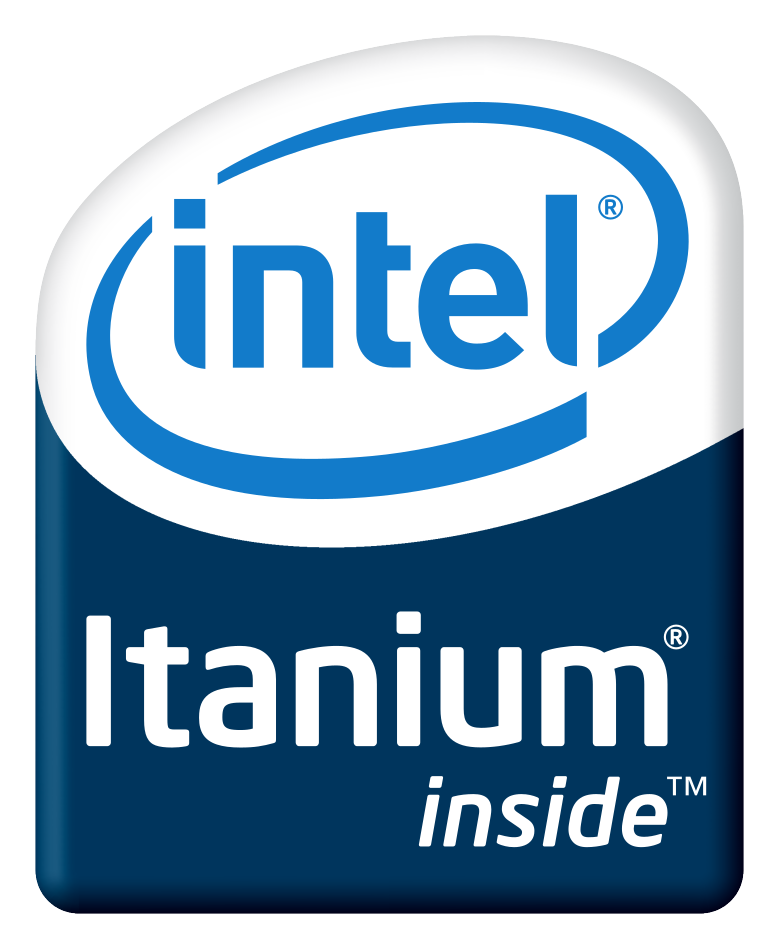

[Itanium](https://en.wikipedia.org/wiki/Itanium) (IA64) är en
processorarkitektur utvecklad av Intel tillsamans med Hewlett Packard (HP) från
2001 till 2020. Arkitekturen använder sig av explicit parallella instruktioner
där flera operationer kan packas ihop i en stor instruktion. Konceptet kallas
även VLIW (Very Long Instruction Word). Arkitekturen släpptes i ett försök att
ersätta x86, men misslyckades så totalt med detta att den blev kallad "Itanic".

Itaniums ankomst troddes även ersätta flera av 80- och 90-talets många
RISC-arkitekturer. Starkast drabbade blev [DEC Alpha](/tjänster/xenofarm/alpha)
och [HP PA-RISC](/tjänster/xenofarm/pa-risc)

## Maskiner

Knappt några operativsystem stödjer fortfarande IA64, så det är mycket svårt
att hitta något rimligt att köra på Xenofarms enstaka HP zx6000. Om det finns
önskemål kan vi försöka starta upp OpenVMS.
