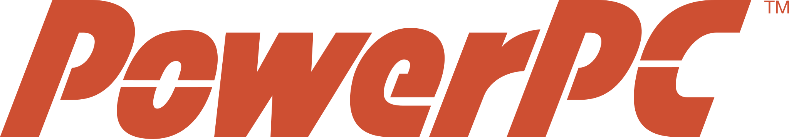

[PowerPC](https://en.wikipedia.org/wiki/PowerPC) (PPC) är en RISC-arkitektur
som lanserades 1991 i ett samarbete mellan Apple, IBM, och Motorola. PowerPC
bytte namn till Power ISA år 2006. PPC användes av Apple i deras Macintosh-serie
av datorer mellan 1994 och 2006 samt i flera spelkonsoller. Dessa inkluderade
Nintendo GameCube, Wii, och Wii U, Microsoft Xbox 360, Sony PlayStation 3.

## Maskiner

Den enda PPC-baserade maskinen Lysator idag har är Castafiore, en IBM RS/6000
3CT. Denna verkar desvärre inte starta, utan hänger på en 888-felkod. Samtliga
donationer av hårdvara uppskattas alltså ytterst.
