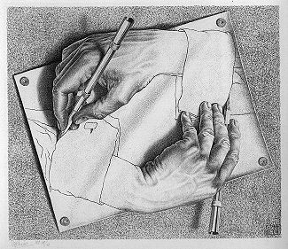

import { Steps, Tabs, TabItem } from '@astrojs/starlight/components';

På LysDocs hittar du information om Lysators tjänster,
guider för diverse teknik och tips för hur man kommer igång som ny medlem.
Du är varm välkommen att bidra till att förbättra lysdocs om du har ideér.



## Lägg till och redigera nya artiklar till datorhandboken

### Utvecklingsmiljön

<Steps>
1. Klona ner handboksrepot [härifrån](https://forge.lysator.liu.se/lysdocs/lysdocs) med
    <Tabs>
        <TabItem label="HTTPS">
            ```bash
            git clone https://forge.lysator.liu.se/lysdocs/lysdocs.git
            ```
        </TabItem>
        <TabItem label="SSH">
            ```bash
            git clone ssh://git@forge.lysator.liu.se/lysdocs/lysdocs.git
            ```
        </TabItem>
    </Tabs>

2. Navigera till toppen av den nedhämtade katalogen och kör
    ```bash
    npm i
    ```
   för att installera alla beroenden

3. För att starta utvecklingsservern kör
    ```bash
    npm run dev
    ```

4. Öppna nu din webbläsare och navigera till http://localhost:4321/ för att se sidan lokalt

5. Mer information om Starlight går att hitta på https://starlight.astro.build/

</Steps>

### Sidredigering

<Steps>
    1. Checka ut en egen gren med
        ```bash
        git checkout -b *<namn på din gren>*
        ```
    2. Gör dina önskade ändringar, spara dem med `git add *<filnamn>*` och `git commit`.
    3. Tryck upp dina önskade ändringar till gitlab med `git push` och logga in på https://forge.lysator.liu.se/lysdocs/lysdocs för att skapa en pull request.
    4. Din request ses över och mergas till eller nekas från master.
</Steps>

### Skapa nya sidor

<Steps>
    1. Skapa en `.md` eller `.mdx` fil i `src/content/docs/[kategori]/`.
    2. Ge den en frontmatter med en titel
        ```mdx
        ---
        title: "Min nya sida"
        ---

        Hej detta är min nya sida
        ```
</Steps>

### Skapa nya kategorier

<Steps>
    1. Skapa en katalog i `src/content/docs`.
    2. Hitta en passande ikon för kategorin.
        Lista på tillgängliga ikoner går att hitta i [Starlights dokumentation](https://starlight.astro.build/reference/icons/#all-icons).
    2. Lägg till din kategori i `astro.config.mjs` under `starlightSidebarTopicsPlugin`.
        Exempel:
        ```js
        {
          id: "[id]"
          label: "[titel]",
          link: "/[katalog]/",
          icon: "[ikon]",
          items: [{ autogenerate: { directory: "[katalog]" } }],
        }
        ```
</Steps>
