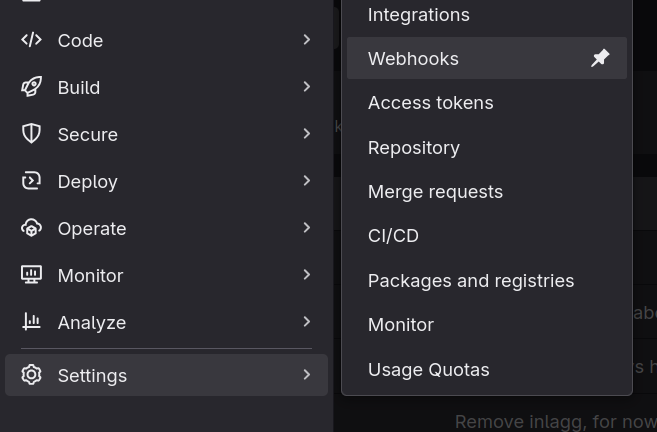
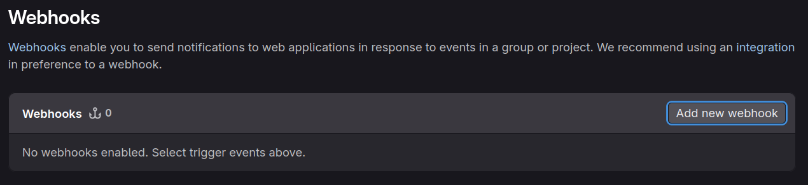
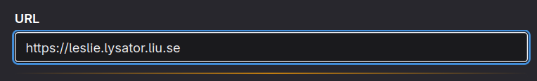
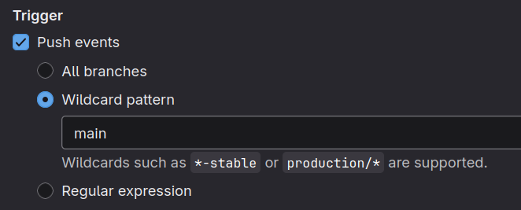
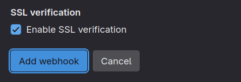

import { Steps } from '@astrojs/starlight/components';

Ett enkelt sätt för Lysatorprojekt att publicera sina statiska sidor på webbservern Leslie.

Källkoden finns i Leslies monorepo: [https://git.lysator.liu.se/www/leslie/-/tree/main/files/publisher](https://git.lysator.liu.se/www/leslie/-/tree/main/files/publisher)

## Hur använder man Publisher?

<Steps>

1. Ha ett gitlab-projekt för hemside-koden.

2. Be mig (sermuns) att lägga till projektet i `projects.yaml` (i publisher:s kod). Jag behöver veta vilka kommandon som ska köras för att bygga den statiska HTML:en. Viktigt är att det i slutändan skapas en `public/`-katalog efter byggkommandona.

3. I gitlab-projektet, skapa en webhook mot leslie:
    1. "Settings" > "Webhooks".
    
    2. "Add new webhook".
    
    3. URL ska vara `https://leslie.lysator.liu.se`.
    
    4. Trigger ska vara "Push events" med "Wildcard pattern"=`main`. Då publiceras koden endast när ändringar sker på `main`, du kan såklart välja själv.
    
    5. Spara.  
    

4. Färdigt! Nu kommer Leslie att bygga och publicera hemsidan varje gång du pushar till `main`-grenen i ditt gitlab-projekt.

</Steps>
